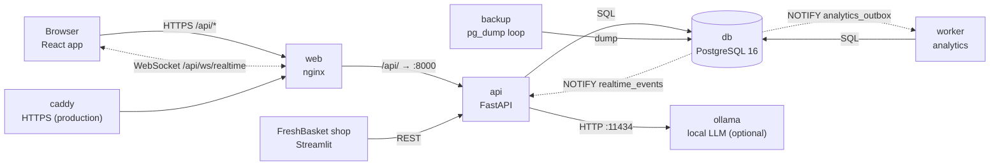
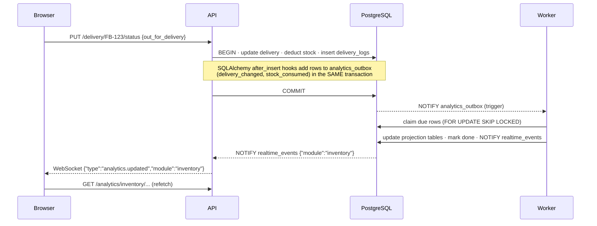

# System architecture

## Components



| Service | Image or source | Job |
|---|---|---|
| `db` | `postgres:16-alpine` | all data, in the `pgdata` volume |
| `api` | `backend/Dockerfile` | REST API and WebSocket. Applies migrations on start, seeds roles and permissions, creates the first admin |
| `worker` | same image, `python -m backend.workers.analytics_worker` | turns business events into analytics tables and announces each update |
| `web` | `frontend/Dockerfile` | nginx serving the built React app. Proxies `/api/` (including the WebSocket) to `api` |
| `backup` | `postgres:16-alpine` + `ops/backup.sh` | `pg_dump` every 24 h into `./backups`, with retention and a free-space check |
| `ollama`, `ollama-pull` | `ollama/ollama` (profile `ai`) | local model server and a one-off model download |
| `simulator` | `client_app/Dockerfile` (profile `simulator`) | FreshBasket Fruits, the demo client on port 8501 |
| `caddy` | `caddy:2-alpine` (`docker-compose.prod.yml`) | public HTTPS with an automatic Let's Encrypt certificate |

Start-up order follows health checks: `db` becomes healthy, then `api` migrates and becomes
healthy, then `worker`, `web` and `simulator` start.

The browser talks only to nginx. It reaches the API at the same origin (`/api`), so the browser
needs no CORS rules and the cookie-free bearer tokens never cross origins. In production only
Caddy publishes ports (80/443); the `api` and `web` ports are closed.

## Backend structure

The backend is a **modular monolith**: one deployable FastAPI app, split into modules that each
own their tables and talk to each other only through a small facade.

```
backend/modules/<module>/
  domain/          pure business rules (no database): enums, transitions, stock arithmetic, CPM
  application/     services (use cases, transactions) and DTOs (request/response schemas)
  infrastructure/  SQLAlchemy models, repository, projection tables
  facade.py        the only entry point other modules may use
  router.py        HTTP endpoints
  analytics.py     outbox event handlers that update the projection tables
  analytics_router.py  read-only analytics endpoints
```

A request goes through the layers in this order:

```
router (auth + permission check, HTTP shape)
  → service (use case, one transaction, maps rule errors to HTTP 400/409)
    → domain rules (pure functions, unit-tested)
    → repository (SQL, row locks)
```

Shared code lives in `backend/core/`: settings, the database session and model registry, JWT
authentication, role-based access control, the realtime bridge and the statistics helpers.

**Why a modular monolith?** A small team gets one codebase, one deploy and real database
transactions across modules. An example is a delivery dispatch that deducts stock: the delivery
and inventory changes commit together or not at all. The module boundaries keep the code
organised, so a module could later be split into its own service.

## Live analytics: the transactional outbox

Dashboards update within about a second of any change, and analytics never slow down or
break the write itself.



1. **Write.** A service changes business rows. ORM `after_insert`/`after_delete` hooks add an
   event row to `analytics_outbox` in the same transaction, so an event exists exactly when the
   change was committed.
2. **Wake.** A trigger on `analytics_outbox` runs `pg_notify('analytics_outbox', id)`. The worker
   `LISTEN`s and also sweeps every `OUTBOX_POLL_TIMEOUT` seconds in case a notification was missed.
3. **Process.** The worker claims a batch with `SELECT … FOR UPDATE SKIP LOCKED`, so several
   workers can run safely. It calls `handle_<event_type>` in `backend/modules/<module>/analytics.py`,
   which updates the projection tables, then marks the row `done`.
4. **Announce.** In the same transaction the worker sends `pg_notify('realtime_events', …)`.
   PostgreSQL delivers it on commit, so the browser never refetches before the new numbers are
   visible.
5. **Push.** The API's realtime listener (a background thread) forwards the event to every
   WebSocket client allowed to read that module. The page then refetches its analytics.

Failures are contained:
- A failing event is retried with exponential backoff up to `OUTBOX_MAX_ATTEMPTS`, then marked
  `dead` so it can't block the queue.
- Rows left `processing` by a crashed worker are reclaimed after `STALE_LOCK_SECONDS`.
- Processed rows are pruned after `OUTBOX_RETENTION_DAYS`.
- `python -m backend.workers.rebuild` recomputes every projection from the source tables.

| Module | Events | Projection tables |
|---|---|---|
| inventory | `stock_consumed`, `stock_returned`, `purchase_order_created` | `inventory_daily_consumption`, `inventory_monthly_orders` |
| accounts | `transaction_created`, `transaction_deleted` | `accounts_daily_totals`, `accounts_daily_category_totals` |
| delivery | `delivery_changed` | `delivery_daily_counts`, `delivery_daily_hour_counts`, `delivery_daily_item_counts`, `delivery_daily_status_counts` |
| organization | `org_changed` | `org_overview_snapshot` |
| projects | `projects_changed` | `projects_portfolio_snapshot`, `project_snapshot` |

## Security

| Concern | How it is handled |
|---|---|
| Passwords | bcrypt hashes (`backend/core/auth/security.py`); at least 8 characters |
| Sessions | JWT bearer tokens (HS256, `ACCESS_TOKEN_EXPIRE_MINUTES`). Each token carries the user's `token_version`; changing or resetting a password increments it, which signs out every other session |
| Permissions | role-based. Every endpoint declares a permission (`inventory.read`, `accounts.write`, `rbac.manage`…); the `admin` role always has all of them. One test checks that routers only use names from the catalogue |
| WebSocket | the first message must be `{"type":"auth","token":…}` within 10 seconds, or the socket closes with code 1008. Events are filtered by the user's read permissions |
| Password reset | single-use random tokens; only the SHA-256 hash is stored; they expire after `PASSWORD_RESET_TTL_MINUTES` |
| Production checks | with `APP_ENV=production` the API refuses to start without a `JWT_SECRET` of 32+ characters |
| AI | the assistant has read-only tools, filtered by the user's permissions; the model runs locally and no data leaves the server |
| Transport | Caddy terminates HTTPS. nginx adds `X-Content-Type-Options`, `X-Frame-Options` and `Referrer-Policy`, and limits request bodies to 2 MB |
| Concurrency | stock changes lock the item row (`SELECT … FOR UPDATE`), so two sales can't both take the last unit |

## AI assistant

```
question → Assistant (backend/modules/ai/assistant.py)
  → Ollama /api/chat with the tools this user may use
  ← tool calls (e.g. inventory_alerts, accounts_summary)
  → run tools against the database (read-only) → send results back
  ← final answer (+ "Looked at: …")
```

- The assistant makes up to 4 tool rounds per question.
- If the model has no tool support, or returns an empty answer, it switches to context mode. In
  context mode the overview tools run first, and their output goes into the prompt.
- **Summarize** on an analytics page sends that module's data and asks for a short briefing.
- See [AI setup](AI_SETUP.md).

## Key design decisions

| Decision | Reason |
|---|---|
| PostgreSQL only | LISTEN/NOTIFY, `SKIP LOCKED` and row locks give a reliable queue and live updates with no extra broker (Redis or Kafka) to run |
| Outbox instead of computing analytics on read | dashboard queries read small pre-aggregated tables, so they stay fast as data grows, and a slow analytics bug can't fail a sale |
| Money as `NUMERIC(14,2)` and timestamps as `timestamptz` (UTC) | no rounding errors; correct times in any time zone |
| Pure domain functions | stock arithmetic, delivery transitions, CPM/PERT, GSTIN checksums and anomaly statistics are unit-tested without a database |
| Local LLM | free to run and private; works offline |
| Docker Compose | one command starts the whole stack the same way on a laptop and on a server |
