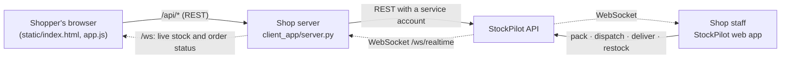

# Client app: FreshBasket Online

`client_app/` is the online store of an imagined fruit seller, **seen from the shopper's side**.
Shoppers browse fruit, check out and track their delivery. The shop's staff fulfil the orders in
the StockPilot web app.

The demo shows StockPilot's inventory, delivery and accounts working together, with live updates
over WebSockets in both apps.



- **No StockPilot accounts or tokens for shoppers.** The shop server signs in to StockPilot with
  one service account and exposes only what a shopper needs.
- **Same API as any client.** It uses the public REST API documented in
  [BACKEND.md](BACKEND.md#api-reference), plus the realtime WebSocket. It never touches the
  database.

## Run it

```bash
docker compose --profile shop up -d --build        # http://localhost:8501
```

1. Open http://localhost:8501. The header shows **Live** once the shop is connected to StockPilot.
2. Click **How the demo works → Stock the shop**. This adds 12 starter fruits to StockPilot
   inventory and books the purchase in Accounts. Skip it if the inventory already holds items.
3. Shop: add fruit to the basket, check out, and you land on the order tracking page.
4. In another window, open StockPilot (http://localhost:8080) → **Delivery**. The order is already
   there.

| Variable | Default | Use |
|---|---|---|
| `SHOP_USERNAME`, `SHOP_PASSWORD` | `ADMIN_USERNAME`, `ADMIN_PASSWORD` | StockPilot account the shop signs in with |
| `SHOP_NAME` | `FreshBasket` | shop name in the header |
| `SHOP_DEMO_TOOLS` | `true` | shows the *Stock the shop* and *Send 5 shoppers* buttons in the demo guide |
| `SHOP_PORT` | `8501` | port on the host |
| `STOCKPILOT_WEB_URL` | `http://localhost:${WEB_PORT}` | where the demo guide's StockPilot links point |
| `STOCKPILOT_API_URL` | `http://api:8000` in Docker | StockPilot API |
| `SHOP_DATA_DIR` | `/data` (volume `shop_data`) | where the shop keeps its order list |

**A dedicated account instead of the admin:**
1. On StockPilot's **Users & Roles**, create a role `shop` with `inventory.read`,
   `inventory.write`, `delivery.read`, `delivery.write` and `accounts.write`.
2. Create a user, for example `freshbasket`, with that role.
3. Set `SHOP_USERNAME` and `SHOP_PASSWORD` in `.env`.

**Without Docker** (the StockPilot API must be running):

```bash
cd client_app
pip install -r requirements.txt
SHOP_USERNAME=admin SHOP_PASSWORD=... uvicorn server:app --port 8501
```

## Demo script

| # | Shopper (FreshBasket) | Staff (StockPilot) | What it shows |
|---|---|---|---|
| 1 | Browse the shop. Stock and "stays fresh N days" come from inventory | | inventory read, expiry dates |
| 2 | Add fruit and check out (name, address, slot, pay on delivery) | the order appears on **Delivery** without a reload | delivery created with stock-linked items; live update |
| 3 | The tracking page shows *Order received* | **Mark packed** | the status workflow |
| 4 | It changes to *Packed*, with a toast | **Dispatch** | live update to the shopper |
| 5 | It changes to *On the way*. The shop's stock count is now final | **Inventory** shows the lower stock by itself | stock deducted on dispatch, with row locking |
| 6 | It changes to *Delivered*, with the amount paid | **Mark delivered**. **Accounts** shows a new *Online sales* credit | the shop records the payment; accounts updates live |
| 7 | | **Mark failed** on another order instead | stock returned automatically |
| 8 | The fruit card changes from *Only 3 left* to *In stock* | **Receive stock** on Inventory | restocks reach the shop live |
| 9 | **Cancel order** while it's *Received* or *Packed* | | cancellation; reserved stock released |
| 10 | Demo guide → **Send 5 shoppers** | **Delivery** fills with orders; open the dashboards and analytics | load for analytics and the AI assistant |

Every update in this table arrives within about a second.

## How the shop works

| Shopper action | Shop server | StockPilot calls |
|---|---|---|
| Open the shop | lists inventory. Available = stock − quantity in this shop's orders not yet dispatched; fruit past its expiry isn't sold | `GET /inventory/` |
| Check out | checks availability again, then creates the order. Order IDs look like `FB-YYMMDD-XXXX` | `POST /delivery/` with `inventory_item_id` on every item |
| Track an order | status and timeline | `GET /delivery/{id}`, `GET /delivery/{id}/logs` |
| Cancel | only while *pending* or *packed* | `PUT /delivery/{id}/status` → `cancelled` |
| (order delivered) | records the payment once per order and remembers that it did | `POST /accounts/` credit, category *Online sales* |

**Live updates:**
1. The server keeps one connection to `ws://api:8000/ws/realtime`, authenticated with its token.
2. An `analytics.updated` event for `inventory` makes every open shop page reload the
   catalogue.
3. An event for `delivery` makes the server check its open orders. It pushes
   `{"type":"order","order_id","status"}` to the browsers watching that order.
4. Browsers connect to the shop's own `/ws` and tell it which orders they're watching.
5. If the StockPilot connection drops, the server reconnects with backoff and re-checks open
   orders every 20 seconds. Pages also fall back to periodic refresh.

**Code layout:**

| File | Contents |
|---|---|
| `server.py` | FastAPI app: `StockPilot` (API client that signs in again on 401), `OrderStore` (orders in `orders.json`), `Hub` (browser WebSockets), `Shop` (catalogue, checkout, tracking, payments, realtime loop, demo tools) |
| `static/index.html`, `styles.css`, `app.js` | the storefront: shop, basket drawer, checkout, order tracking, my orders, demo guide. Plain JavaScript, no build step. The basket and the list of order IDs live in `localStorage` |
| `Dockerfile`, `requirements.txt` | Python 3.12 image running `uvicorn server:app` on port 8501 |

Tests: `tests/unit/test_customer_shop.py` runs the shop logic against an in-memory fake of the
StockPilot API. It covers availability and reservations, the checkout payload, paying exactly
once, cancellation rules and token refresh.
