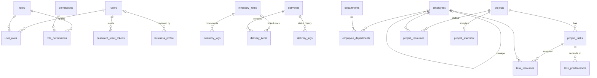

# Database

StockPilot uses **PostgreSQL 16** through SQLAlchemy 2 (`psycopg2` driver). Alembic manages the
schema. The database is the single source of truth, the job queue (outbox) and the message bus
for live updates (LISTEN/NOTIFY).

## Connection setup

| Setting | Use |
|---|---|
| `DATABASE_URL` | the main pooled connection for the API and worker. Docker Compose builds it from `POSTGRES_USER`, `POSTGRES_PASSWORD` and `POSTGRES_DB` |
| `DIRECT_DATABASE_URL` | optional. Used for LISTEN/NOTIFY, which doesn't work through connection poolers such as Neon's. Falls back to `DATABASE_URL` |
| `DB_ECHO` | logs every SQL statement (debugging) |

- **Session and engine:** `backend/core/database/session.py` creates the engine with
  `pool_pre_ping`.
- **Per-request sessions:** `backend/core/database/adapter.py:get_db` gives each request its own
  session.
- **Model registry:** `backend/core/database/registry.py` imports every model module once at
  start-up, so relationships between modules resolve. Add new model modules there.

## Entity-relationship diagram



`transactions`, `analytics_outbox` and the projection tables stand alone. Accounts links to other
modules only by text, through `source_target` and `category`.

## Tables

### Users and access control

| Table | Key columns | Notes |
|---|---|---|
| `users` | `id`, `username` (unique), `email` (unique), `hashed_password`, `is_active`, `token_version` | `token_version` is raised on a password change, which invalidates older JWTs |
| `roles` | `id`, `name` (unique) | `admin` is seeded and always holds every permission |
| `permissions` | `id`, `name` | seeded from `backend/core/rbac/permissions.py` on every start |
| `user_roles`, `role_permissions` | link tables | cascade on delete |
| `password_reset_tokens` | `user_id`, `token_hash` (SHA-256), `expires_at`, `used_at`, `created_by_user_id` | single use. The raw token is only in the link |

### Inventory

| Table | Key columns | Rules |
|---|---|---|
| `inventory_items` | `name` (unique), `quantity`, `on_order_quantity`, `price NUMERIC(14,2)`, `status` (`under_use`/`ordered`/`consumed`), `expiry_date` | `CHECK quantity >= 0`, `on_order_quantity >= 0`, `price >= 0` |
| `inventory_logs` | `item_id`, `action` (add/consume/deliver/order/return/status_change), `quantity`, `detail`, `timestamp` | every stock movement; source of consumption analytics |

### Delivery

| Table | Key columns | Rules |
|---|---|---|
| `deliveries` | `order_id` (unique), `customer_id`, `status`, `remarks`, `stock_deducted`, `created_at`, `completed_at` | `stock_deducted` stops stock being deducted or returned twice |
| `delivery_items` | `delivery_id`, `inventory_item_id` (nullable), `product_name`, `quantity`, `unit_price` | `CHECK quantity > 0`, `unit_price >= 0` |
| `delivery_logs` | `delivery_id`, `from_status`, `to_status`, `remark`, `timestamp` | status history; each row emits `delivery_changed` |

### Accounts

| Table | Key columns | Rules |
|---|---|---|
| `transactions` | `amount NUMERIC(14,2)`, `transaction_type` (`credit`/`debit`), `source_target`, `category`, `remarks`, `date` | `CHECK amount > 0`; indexed by date, type + date, category and counterparty |

### Organization

| Table | Key columns | Rules |
|---|---|---|
| `employees` | `employee_id` (unique business code), `name`, `salary`, `job_role`, `manager_id → employees.id` | `CHECK salary >= 0`. The service prevents reporting loops |
| `departments` | `name` (unique) | |
| `employee_departments` | `employee_db_id`, `department_id` | many-to-many |

### Projects

| Table | Key columns | Notes |
|---|---|---|
| `projects` | `title`, `description`, `start_date`, `deadline` | |
| `project_tasks` | `project_id`, `name`, `duration_days`, `optimistic`, `most_likely`, `pessimistic` | three-point estimates feed PERT |
| `task_predecessors` | `task_id`, `predecessor_id` | dependency graph. Cycles are rejected |
| `task_resources`, `project_resources` | link to `employees.employee_id` | used for resource-conflict detection |

### Business profile

| Table | Key columns | Notes |
|---|---|---|
| `business_profile` | `legal_name`, `trade_name`, `gstin`, `pan`, `cin`, `state_code`, `verification_status`, `verification_report` (JSON), `reviewed_by_user_id`, `reviewed_at` | `CHECK id = 1`: exactly one row |

### Outbox and analytics projections

| Table | Content |
|---|---|
| `analytics_outbox` | `module`, `event_type`, `payload` (JSON), `status` (pending/processing/done/failed/dead), `attempts`, `last_error`, `available_at`, `locked_at`, `processed_at` |
| `inventory_daily_consumption` | units consumed per day |
| `inventory_monthly_orders` | purchase orders per month |
| `accounts_daily_totals` | income and expenses per day |
| `accounts_daily_category_totals` | per day × category × credit/debit |
| `delivery_daily_counts`, `delivery_daily_hour_counts`, `delivery_daily_item_counts`, `delivery_daily_status_counts` | delivered per day, per hour of day, per product, and status changes per day |
| `org_overview_snapshot` | JSON snapshot: headcount, departments, salary histogram, hierarchy |
| `projects_portfolio_snapshot`, `project_snapshot` | JSON snapshots: schedule, critical path, risk for each project |

Projection tables hold only derived data. `python -m backend.workers.rebuild [module …]` can
always rebuild them from the source tables. Stop the worker while it runs.

## Integrity and concurrency

- **Check constraints:** quantities, prices and amounts can't go negative or invalid, whatever
  code path writes them.
- **Row locks:** every stock movement runs `SELECT … FOR UPDATE` on the item. A delivery
  dispatch locks the delivery, then its items, so concurrent orders can't oversell.
- **One transaction per use case:** a delivery status change, its stock movements, its log rows
  and its outbox events commit together.
- **Job queue:** the worker claims outbox rows with `FOR UPDATE SKIP LOCKED`, so running several
  workers never processes an event twice.
- **Types:** all money columns are `NUMERIC(14,2)` and all timestamps `timestamptz` in UTC.

## Triggers and notifications

| Channel | Sent by | Listened to by |
|---|---|---|
| `analytics_outbox` | trigger `analytics_outbox_notify_trigger` (after insert on `analytics_outbox`) | analytics worker |
| `realtime_events` | worker, after processing an event (inside its transaction) | API realtime listener → WebSocket clients |

## Migrations

Alembic config: `backend/alembic.ini`; scripts in `backend/alembic/versions/`.

| Order | Revision | What it does |
|---|---|---|
| 1 | `99202356a1d1` baseline | original v1 schema |
| 2 | `d968c2f705f0` | outbox NOTIFY trigger |
| 3 | `e4f7a2c91b30` | delivery analytics projection tables |
| 4 | `f1c3a9d2b7e4` overhaul v2 | money → `NUMERIC(14,2)`, timestamps → `timestamptz`, stock-linked delivery items, business profile, RBAC cascades, check constraints, delivery analytics rebuild |
| 5 | `a7d4e1c9b2f3` | password reset tokens and `users.token_version` |

```bash
alembic -c backend/alembic.ini upgrade head            # apply (the api container does this on start)
alembic -c backend/alembic.ini revision -m "add x"     # new empty migration
alembic -c backend/alembic.ini upgrade head --sql      # print SQL without a database (CI checks this)
```

**Upgrading a v1 database:** back it up first, then run `upgrade head`. Migration `f1c3a9d2b7e4`
converts the data in place and rebuilds the delivery analytics, which v1 over-counted. It also
queues organization and project snapshot rebuilds. Existing users keep their accounts; grant
the first admin with `create_admin`.

When you add or change a model, write a migration for it. Tests build the schema with
`upgrade head`, so a model without a migration fails CI.

## Backups and restore

The `backup` service (`ops/backup.sh`) runs `pg_dump -Fc` every `BACKUP_INTERVAL_HOURS` into
`./backups/stockpilot-YYYYmmdd-HHMMSS.dump`. It deletes dumps older than
`BACKUP_RETENTION_DAYS`, and skips a run if less than `BACKUP_MIN_FREE_MB` is free.

```bash
docker compose exec backup backup.sh now
docker compose exec backup backup.sh list
docker compose stop api worker
docker compose exec backup backup.sh restore stockpilot-YYYYmmdd-HHMMSS.dump
docker compose start api worker
```

Copy backups to another machine or cloud drive from time to time.

## Useful queries

```sql
-- Analytics queue health
SELECT status, count(*) FROM analytics_outbox GROUP BY status;

-- Events that gave up, and why
SELECT id, module, event_type, attempts, last_error FROM analytics_outbox WHERE status = 'dead';
-- after fixing the cause:
UPDATE analytics_outbox SET status = 'pending', attempts = 0, available_at = now() WHERE status = 'dead';

-- Stock movement history of one item
SELECT action, quantity, detail, timestamp FROM inventory_logs WHERE item_id = 1 ORDER BY timestamp DESC;
```

Open a SQL shell with `docker compose exec db psql -U stockpilot stockpilot`.
